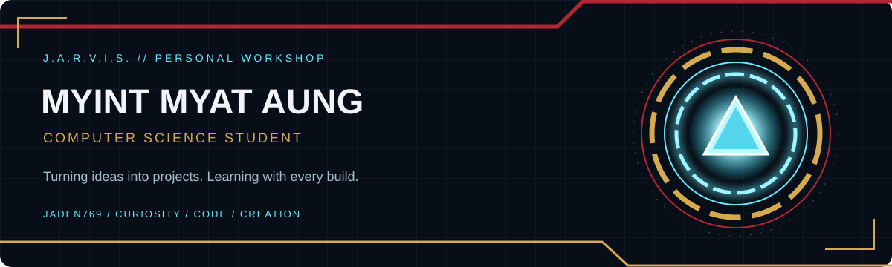

**“Welcome back, sir. The workshop is ready.”**

[Enter the workshop](https://github.com/jaden769?tab=repositories) · [Explore my projects](https://github.com/jaden769?tab=repositories)

---

## 01 / OPERATOR DOSSIER

**Myint Myat Aung** · `jaden769` · Computer Science Student · he/him

Tony Stark inspired the workshop aesthetic. Curiosity keeps it running.

I'm a **computer science student who loves turning ideas into working projects**. I enjoy exploring new technologies, solving problems, and learning by building — from small experiments to more ambitious applications.

This workshop is where I share what I create, what I discover, and how I grow as a developer. There's always another idea to try and another project to build.

> **Workshop principle:** Stay curious. Build something useful. Keep improving.

## 02 / ARMOR SYSTEMS

A growing toolkit, shaped by the projects I build and the problems I explore.

| System | Component | Role in the workshop |
| :--- | :--- | :--- |
| ⚙️ Core runtime | **Python** | Programming, scripting, and experiments |
| 🔌 Interface | **FastAPI** | Application APIs |
| 💾 State recorder | **SQLite** | Data storage and application state |
| 🧪 Diagnostics | **Pytest** | Repeatable checks and regression tests |
| 🛠️ Version control | **Git & GitHub** | Track each iteration |

## 03 / PROJECT BAY

### Featured build: VeriAgent

[**VeriAgent**](https://github.com/jaden769/veriagent) is an executable research sandbox for **evidence-grounded verification and bounded recovery**.

**The experiment:** A tool reports success, but its update never reaches the application state. What should an agent do next?

| Protocol | Behavior |
| :--- | :--- |
| **BASELINE** | Accept the tool's report |
| **VERIFY** | Check persisted state independently |
| **RECOVER** | Retry eligible unmet requirements within explicit budgets, then check again |

The workshop includes deterministic experiments, event traces, and browser fault controls. It is a research prototype with results limited to controlled scenarios.

More builds will join the workshop as I explore new ideas. [Browse all repositories →](https://github.com/jaden769?tab=repositories)

## 04 / LIVE TELEMETRY

---

### IMAGINE. BUILD. ITERATE.

**The next prototype starts with a better question.**

A personal workshop inspired by Tony Stark's engineering spirit.

